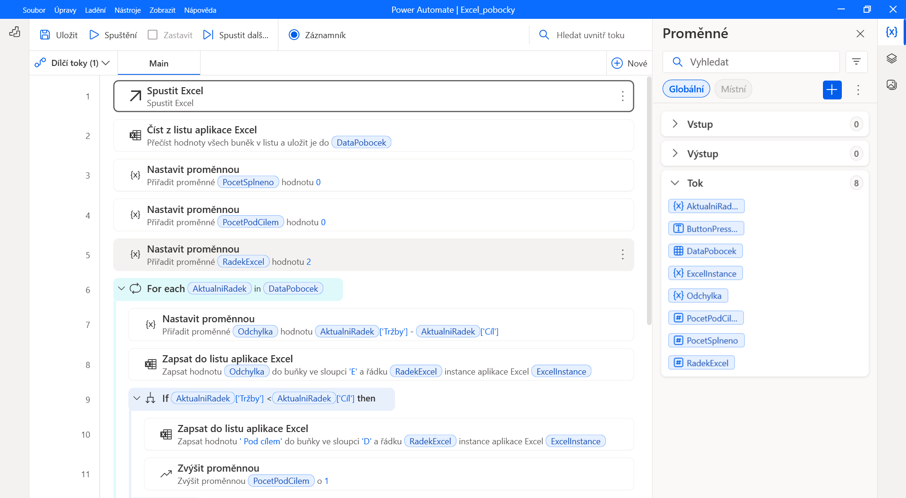
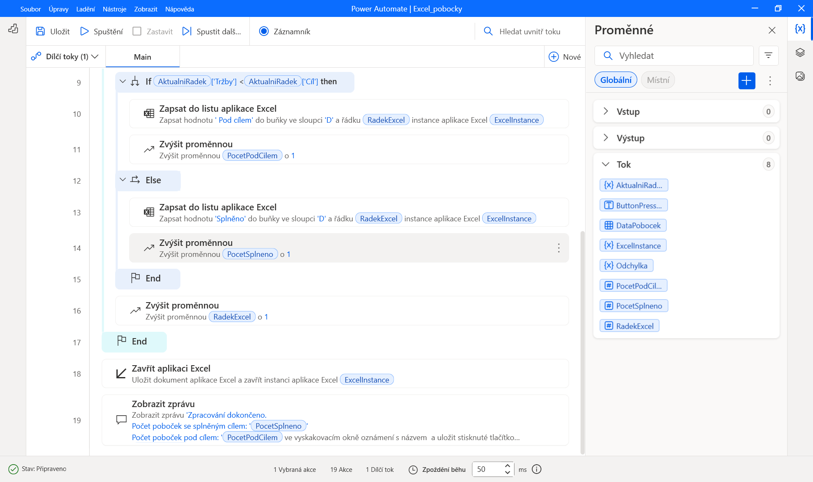
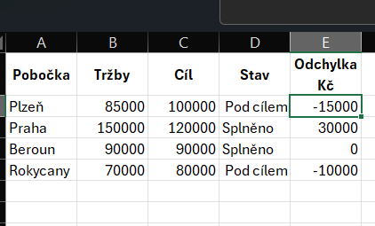

# Case Study 03 — Branch Sales Check with Power Automate Desktop

Praktická implementace lokální automatizace kontroly plnění tržeb poboček v Excelu pomocí Power Automate Desktop.

Desktopový tok otevře sešit, porovná skutečné tržby jednotlivých poboček s jejich cílem, doplní stav a odchylku v Kč a uloží výsledky. Po dokončení zobrazí souhrnný počet poboček se splněným cílem a počet poboček pod cílem.

---

## Cíl projektu

Cílem bylo vytvořit opakovatelný proces, který:
- načte údaje o tržbách a cílech z Excelu;
- projde všechny datové řádky;
- vypočítá rozdíl mezi skutečnými tržbami a cílem;
- přiřadí každé pobočce stav `Splněno` nebo `Pod cílem`;
- zapíše výsledky do stejného sešitu;
- spočítá pobočky v obou kategoriích;
- uloží sešit, zavře použitou instanci Excelu a zobrazí souhrnnou zprávu.

---

## Struktura projektu

```text
03-branch-sales-check-power-automate/
├── output/
│   └── Trzby_pobocky.xlsx
├── screenshots/
│   ├── 01_flow_start.png
│   ├── 02_flow_result.png
│   └── 03_excel_output.png
└── README.md
```

Soubor v adresáři `output` obsahuje výsledný sešit po zpracování. Sloupce `Pobočka`, `Tržby` a `Cíl` představují vstupní údaje; sloupce `Stav` a `Odchylka Kč` doplňuje automatizace.

Tok je zdokumentován screenshoty a popisem postupu. Jeho zdrojový text ani importovatelný balíček nejsou součástí této případové studie.

---

## Business scénář

Vedoucí pobočkové sítě potřebuje vyhodnotit, které pobočky splnily stanovený cíl tržeb a o kolik se jejich skutečný výsledek od cíle liší.

Ruční postup by zahrnoval porovnání hodnot u každé pobočky, výpočet rozdílu, doplnění stavu a sestavení souhrnu. Automatizace tyto kroky provede podle stejných pravidel pro všechny řádky.

Studie používá malý modelový dataset čtyř poboček. Jejím účelem je prakticky ověřit práci s Excelem, proměnnými, podmínkami a cyklem v Power Automate Desktop.

---

## Použité technologie

- Power Automate Desktop — řízení lokálního procesu pomocí vizuálně sestavených akcí;
- Microsoft Excel — zdroj vstupních údajů a uložení výsledků;
- proměnné a datová tabulka — uchování načtených dat, počítadel a průběžných výsledků;
- cyklus `For each` — postupné zpracování poboček;
- podmínka `If / Else` — rozhodnutí o splnění cíle.

---

## Vstupní data a business pravidla

Každý datový řádek představuje jednu pobočku. První řádek listu obsahuje záhlaví.

| Sloupec | Obsah | Role |
|---|---|---|
| A — Pobočka | Název pobočky | Vstup |
| B — Tržby | Skutečné tržby v Kč | Vstup |
| C — Cíl | Cílové tržby v Kč | Vstup |
| D — Stav | Výsledek porovnání s cílem | Výstup |
| E — Odchylka Kč | Rozdíl skutečných tržeb a cíle | Výstup |

Odchylka se počítá jako:

```text
Odchylka Kč = Tržby − Cíl
```

- záporná odchylka znamená nedosažení cíle;
- nulová odchylka znamená přesné splnění cíle;
- kladná odchylka znamená překročení cíle.

Pokud jsou `Tržby < Cíl`, přiřadí se stav `Pod cílem`. V ostatních případech se přiřadí `Splněno`. Přesné dosažení cíle tedy patří mezi splněné výsledky.

---

## Průběh procesu

1. Otevření připraveného sešitu v Excelu a uložení instance do `ExcelInstance`.
2. Načtení dat z listu do datové tabulky `DataPobocek` s použitím prvního řádku jako záhlaví.
3. Nastavení počítadel `PocetSplneno` a `PocetPodCilem` na `0`.
4. Nastavení proměnné `RadekExcel` na `2`, protože první řádek obsahuje záhlaví.
5. Spuštění cyklu `For each` nad řádky tabulky `DataPobocek`.
6. Výpočet proměnné `Odchylka` jako rozdílu hodnot `Tržby` a `Cíl` aktuálního řádku.
7. Zápis odchylky do sloupce E na řádek určený proměnnou `RadekExcel`.
8. Vyhodnocení podmínky `Tržby < Cíl`, zápis stavu do sloupce D a zvýšení odpovídajícího počítadla.
9. Zvýšení `RadekExcel` o `1` a pokračování další pobočkou.
10. Po dokončení cyklu uložení sešitu a zavření instance Excelu.
11. Zobrazení souhrnné zprávy s počty poboček v obou kategoriích.

Uložení a zavření Excelu probíhá až za koncem cyklu, po zpracování všech poboček.



---

## Hlavní proměnné

| Proměnná | Účel |
|---|---|
| `ExcelInstance` | Instance Excelu používaná pro čtení, zápis a zavření sešitu |
| `DataPobocek` | Datová tabulka načtená z listu |
| `AktualniRadek` | Právě zpracovávaný řádek v cyklu |
| `RadekExcel` | Číslo řádku pro zápis do Excelu, začíná hodnotou 2 |
| `Odchylka` | Rozdíl skutečných tržeb a cíle aktuální pobočky |
| `PocetSplneno` | Počet poboček, které dosáhly nebo překročily cíl |
| `PocetPodCilem` | Počet poboček, které cíle nedosáhly |
| `ButtonPressed` | Výstup akce zobrazení zprávy; neovlivňuje výpočet |

---

## Výsledky ověřovacího běhu

Výsledný sešit obsahuje následující hodnoty:

| Pobočka | Tržby Kč | Cíl Kč | Stav | Odchylka Kč |
|---|---:|---:|---|---:|
| Plzeň | 85 000 | 100 000 | Pod cílem | −15 000 |
| Praha | 150 000 | 120 000 | Splněno | 30 000 |
| Beroun | 90 000 | 90 000 | Splněno | 0 |
| Rokycany | 70 000 | 80 000 | Pod cílem | −10 000 |

Ověřovací dataset pokrývá všechny tři situace: výsledek pod cílem, nad cílem i přesně na cíli. Výstup potvrzuje správné znaménko odchylky a zařazení nulové odchylky do kategorie `Splněno`.

Souhrnná zpráva na konci toku uvádí:

- počet poboček se splněným cílem: **2**;
- počet poboček pod cílem: **2**.





[Otevřít výsledný sešit](output/Trzby_pobocky.xlsx)

---

## Opakované spuštění

Počítadla se na začátku každého běhu nastaví na nulu. Výsledky se zapisují do stejných buněk ve sloupcích D a E, takže při opakovaném spuštění nad stejnými vstupy nevznikají další řádky ani se nesčítají počty z předchozího běhu.

Pokud se změní tržby nebo cíl, další běh přepočítá odchylku a přepíše původní stav. Tok neukládá historii předchozích výsledků.

---

## Lokální spuštění a reprodukce

### Požadavky

- Windows s nainstalovaným Power Automate Desktop;
- desktopová aplikace Microsoft Excel;
- lokálně uložený sešit s odpovídající strukturou a číselnými hodnotami tržeb a cílů.

### Postup

1. Stáhnout si pracovní kopii souboru `output/Trzby_pobocky.xlsx`.
2. V Power Automate Desktop sestavit tok podle popisu a screenshotů výše.
3. V akci spuštění Excelu nastavit cestu k pracovní kopii sešitu.
4. Při čtení listu použít první řádek jako názvy sloupců a ověřit názvy `Tržby` a `Cíl`.
5. Ponechat vstupní sloupce A–C a výstupní sloupce D–E ve stejném pořadí.
6. Spustit celý tok z návrháře Power Automate Desktop.
7. Po dokončení ověřit souhrnnou zprávu a uložené hodnoty v sešitu.

Případová studie obsahuje dokumentaci a výsledný sešit. Pro reprodukci je nutné tok v aplikaci sestavit; samotné stažení adresáře automatizaci nenainstaluje.

---

## Rozsah a omezení

Řešení představuje základní lokální automatizaci spouštěnou ručně. Pracuje s připravenou strukturou listu a předpokládá platné vstupní údaje.

Aktuální varianta neobsahuje:

- samostatnou validaci chybějících sloupců, prázdných hodnot nebo nečíselných vstupů;
- kontrolu duplicitních poboček;
- vlastní chybový dílčí tok ani logování do souboru;
- archivaci výsledků jednotlivých běhů;
- automatické časové spouštění;
- odesílání reportu nebo upozornění.

Zápis používá pevně určené sloupce D a E a předpokládá souvislé datové řádky od řádku 2. Při změně rozložení listu je nutné upravit také tok. Protože se výsledky ukládají do stejného sešitu, doporučuje se při zkoušení používat pracovní kopii.

---

## Přínos a volba nástroje

Studie ukazuje propojení čtení a zápisu do Excelu s řízením procesu: cyklem, podmínkou, počítadly a závěrečnou zprávou.

Pro samotný výpočet odchylky a stavu by v běžné praxi byly jednodušší excelové vzorce. Power Query by bylo vhodné při přípravě a spojování dat z více souborů. Power Automate Desktop zde slouží především k procvičení automatizace celého postupu v desktopové aplikaci; větší přínos by měl při navazujících úkonech v dalších aplikacích.

---

## Možná další rozšíření

- ověření struktury a kvality vstupních dat před zápisem;
- zachycení chyb a zápis výsledku běhu do logu;
- oddělení vstupního a výstupního sešitu;
- archivace výstupu podle data zpracování;
- zpracování více souborů nebo více období;
- doplnění přehledu celkových tržeb a cílů;
- navazující předání výsledného reportu.