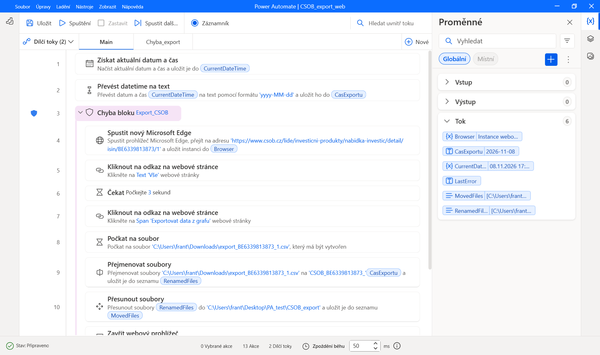
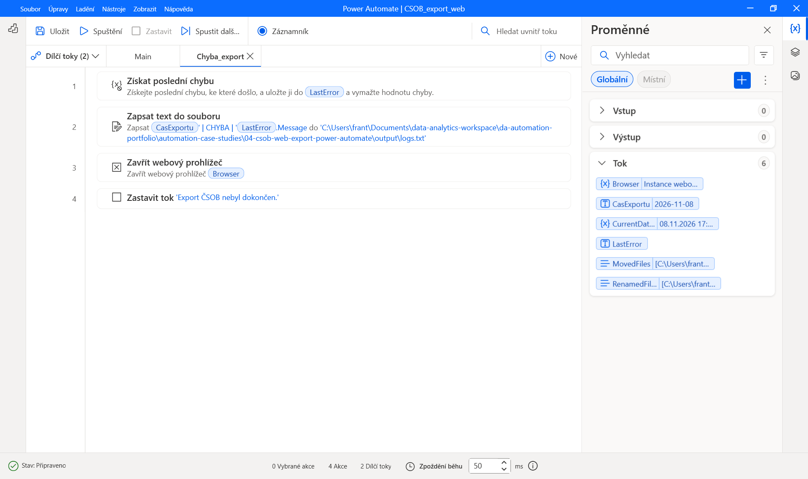
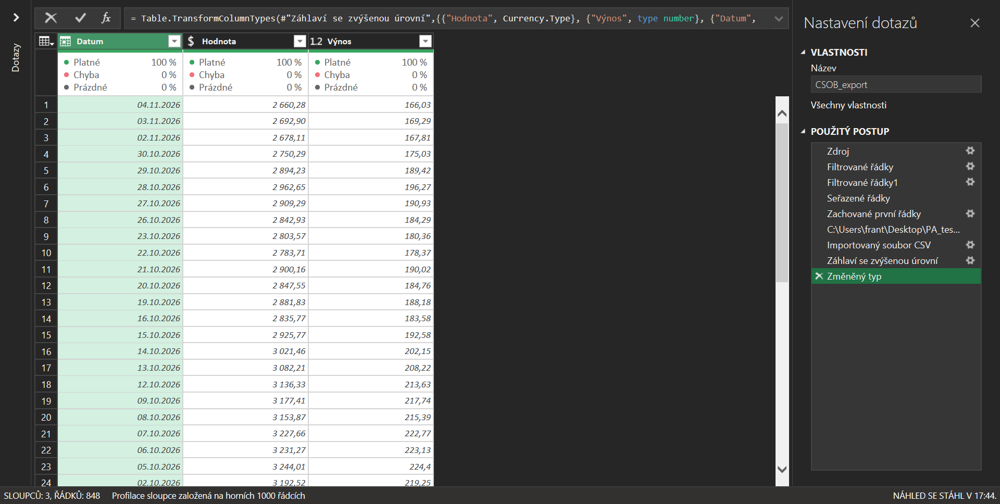

# Case Study 04 — ČSOB Web Export with Power Automate Desktop

Praktická implementace lokální automatizace stažení historických dat investičního fondu z webu ČSOB pomocí Power Automate Desktop a jejich následného načtení do Excelu prostřednictvím Power Query.

Desktopový tok otevře stránku fondu, vybere celé dostupné období, stáhne CSV, přejmenuje soubor podle data exportu a přesune jej do cílové složky. Výsledek zaznamená do logu. Při chybě spustí samostatný dílčí tok, který uloží chybovou zprávu, pokusí se zavřít prohlížeč a ukončí zpracování.

Jde o samostatnou případovou studii webové automatizace. Řešení není součástí Python pipeline projektu analýzy investičních fondů.

---

## Cíl projektu

Cílem bylo vytvořit opakovatelný proces, který:

- otevře veřejnou stránku vybraného fondu;
- nastaví celé dostupné období grafu;
- vyvolá export historických dat do CSV;
- počká na vytvoření očekávaného souboru;
- doplní do názvu souboru datum exportu;
- přesune soubor do cílové složky a zachová exporty z předchozích dnů;
- zaznamená úspěch nebo chybu do textového logu;
- po dokončení zavře použitý prohlížeč;
- umožní načtení nejnovějšího exportu do Excelu přes Power Query.

---

## Struktura projektu

```text
04-csob-web-export-power-automate/
├── data/
│   ├── CSOB_BE6339813873_2026-11-07.csv
│   └── CSOB_BE6339813873_2026-11-08.csv
├── excel/
│   └── CSOB.xlsx
├── output/
│   └── logs.txt
├── power-automate/
│   ├── error_flow.txt
│   └── main_flow.txt
├── screenshots/
│   ├── 01_main_flow.png
│   ├── 02_error_flow.png
│   └── 03_power_query.png
└── README.md
```

- `data` obsahuje ukázky denních exportů s úplnou dostupnou historií fondu;
- `excel/CSOB.xlsx` obsahuje navazující dotaz Power Query;
- `output/logs.txt` obsahuje záznamy o průběhu zpracování;
- `power-automate` obsahuje textové kopie akcí hlavního a chybového dílčího toku;
- `screenshots` dokumentují tok a výsledek načtení dat.

Soubory TXT s akcemi slouží k přenosu do návrháře Power Automate Desktop. Nejde o samostatně spustitelné skripty.

---

## Business scénář

Uživatel pravidelně získává historické hodnoty fondu pro další práci v Excelu. Ruční postup vyžaduje otevření webu, nastavení období, stažení souboru, přejmenování a přesun do správné složky.

Automatizace přebírá tyto opakující se úkony. Denní exporty zůstávají uložené samostatně a Power Query vybírá nejnovější z nich jako zdroj aktuálního přehledu.

Archiv představuje historii stažených souborů. Samotný nejnovější CSV export již obsahuje celou dostupnou časovou řadu, takže pro aktuální přehled není potřeba spojovat všechny denní exporty.

---

## Použité technologie

- Power Automate Desktop — řízení webové automatizace a práce se soubory;
- Microsoft Edge — otevření stránky a stažení exportu;
- webové prvky a selektory — identifikace ovládacích prvků stránky;
- CSV — uložení exportovaných dat;
- textový log — záznam výsledků a chyb;
- Microsoft Excel a Power Query — výběr nejnovějšího souboru a příprava tabulky.

---

## Zdroj a struktura dat

Použitý fond:

- název: **ČSOB Akciový pro digitalizaci zodpovědný**;
- ISIN: **BE6339813873**;
- měna: **CZK**.

[Zdrojová stránka fondu](https://www.csob.cz/lide/investicni-produkty/nabidka-investic/detail/isin/BE6339813873/1)

Export obsahuje tři sloupce:

| Sloupec | Obsah | Typ v Power Query |
|---|---|---|
| Datum | Datum hodnoty fondu | Datum |
| Hodnota | Hodnota podílového listu v Kč | Pevné desetinné číslo — měna |
| Výnos | Výnos uvedený ve zdrojovém exportu v procentech | Desetinné číslo |

Hodnota `166,03` ve sloupci `Výnos` znamená `166,03 %`, nikoli denní výnos. Sloupec zůstává desetinným číslem. Pro použití procentního datového formátu by bylo nutné hodnoty nejprve vydělit stem.

Datum v názvu souboru označuje den stažení. Nemusí odpovídat poslednímu datu uvnitř exportu: web může mít k dispozici hodnoty pouze k dřívějšímu dni.

---

## Rozdělení odpovědností

| Část řešení | Odpovědnost |
|---|---|
| Hlavní tok `Main` | Otevření stránky, export, přejmenování, přesun souboru a dokončení běhu |
| Chybový tok `Chyba_export` | Záznam poslední chyby, pokus o zavření prohlížeče a ukončení toku |
| Power Query | Výběr nejnovějšího exportu, načtení CSV, záhlaví a datové typy |
| Uživatel | Ruční spuštění desktopového toku a následná aktualizace dotazu v Excelu |

Stažení souboru a aktualizace Power Query jsou dva samostatné kroky. Desktopový tok v této variantě automaticky neobnovuje sešit Excelu.

---

## Průběh hlavního toku

1. Získání aktuálního data a času do proměnné `CurrentDateTime`.
2. Převod na text ve formátu `yyyy-MM-dd` do proměnné `CasExportu`.
3. Zahájení bloku zpracování chyb `Export_CSOB`.
4. Spuštění Microsoft Edge na stránce fondu a uložení instance do `Browser`.
5. Kliknutí na volbu období `Vše`.
6. Čekání 3 sekundy na aktualizaci grafu.
7. Kliknutí na `Exportovat data z grafu`.
8. Čekání na vytvoření souboru `export_BE6339813873_1.csv` ve složce Stažené soubory.
9. Přejmenování souboru na `CSOB_BE6339813873_<datum exportu>.csv` při zachování přípony.
10. Přesun přejmenovaného souboru do cílové složky.
11. Zavření použité instance prohlížeče.
12. Zápis úspěšného výsledku do logu.

Datum exportu se připravuje ještě před chráněným blokem, aby bylo k dispozici také pro zápis chyby.



---

## Čekání a webové prvky

Proces používá dva odlišné typy čekání:

- pevné čekání 3 sekundy po výběru období grafu;
- čekání na vznik konkrétního souboru po kliknutí na export.

Čekání na soubor má nastavený časový limit a při jeho překročení vyvolá chybu. Tím se zabrání neomezenému čekání, pokud export nevznikne.

Při přípravě toku bylo nutné upravit selektor grafu, protože původně obsahoval proměnlivé ID generované knihovnou Highcharts. U exportu bylo použito kliknutí bez odeslání fyzického kliknutí myši.

Selektor určuje, který prvek webu má automatizace použít. Změna struktury stránky nebo jejích ovládacích prvků může vyžadovat jeho opětovné nastavení.

---

## Pojmenování a historie souborů

Archivované exporty používají formát:

```text
CSOB_<ISIN>_<YYYY-MM-DD>.csv
```

Příklad:

```text
CSOB_BE6339813873_2026-11-08.csv
```

Formát data umožňuje řadit názvy souborů podle dne exportu. Název neobsahuje hodiny ani sekundy; cílem je uchovávat jednu verzi za den. Opakovaný export ve stejný den má nahradit soubor stejného jména, proto je při přesunu potřeba nastavit přepsání existujícího cíle.

Každý soubor obsahuje úplnou historii dostupnou v okamžiku stažení. Dva exporty z různých dnů mohou mít shodný obsah, pokud mezitím nebyla zveřejněna nová hodnota.

---

## Zpracování chyb

Chyby v bloku `Export_CSOB` předává hlavní tok do dílčího toku `Chyba_export`.

Chybový tok provede:

1. Získání poslední chyby do proměnné `LastError`.
2. Zápis data, stavu `CHYBA` a textu `LastError.Message` do logu.
3. Pokus o zavření prohlížeče uloženého v `Browser`.
4. Zastavení toku s chybovou zprávou `Export ČSOB nebyl dokončen.`

Akce zavření prohlížeče v chybovém toku je nastavena tak, aby při vlastním selhání pokračovala k ukončení toku. Původní chyba je zapsána ještě před pokusem o zavření.



---

## Logování

Výsledky běhů se připojují do souboru [output/logs.txt](output/logs.txt).

Záznam používá strukturu:

```text
datum exportu | stav | zpráva
```

Příklad úspěšného záznamu:

```text
2026-11-08 | OK | Export stažen a přesunut.
```

Příklady chyb zaznamenaných při ověřování:

```text
2026-11-08 | CHYBA | Soubor k přejmenování nenalezen
2026-11-08 | CHYBA | Časový limit vypršel.
```

Log obsahuje datum bez času. Při více bězích během jednoho dne vznikne více řádků se stejným datem; aktuální varianta nemá samostatný identifikátor běhu.

Stav `OK` popisuje dokončení desktopového exportu. Nepotvrzuje automatickou aktualizaci Power Query ani zveřejnění novější hodnoty fondu.

---

## Navazující Power Query

Dotaz `CSOB_export` v sešitu [excel/CSOB.xlsx](excel/CSOB.xlsx) načítá soubory ze složky `data`, jejíž cesta se odvozuje od umístění sešitu.

Postup dotazu:

1. Načtení seznamu souborů ve zdrojové složce.
2. Filtrování souborů s příponou `.csv`.
3. Filtrování názvů začínajících `CSOB_BE6339813873_`.
4. Seřazení názvů sestupně podle data obsaženého v názvu.
5. Zachování prvního souboru.
6. Načtení jeho binárního obsahu.
7. Import CSV a použití prvního řádku jako záhlaví.
8. Nastavení datových typů sloupců `Datum`, `Hodnota` a `Výnos`.

Navigační krok vybírá obsah prvního řádku výsledného seznamu:

```powerquery
= #"Zachované první řádky"{0}[Content]
```

Tím se výběr neváže na konkrétní název exportu. Při další aktualizaci dotaz vybere soubor s nejnovějším datem v názvu.

Denní exporty se nespojují pod sebe, protože každý z nich obsahuje úplnou historickou řadu. Jejich prosté připojení by vytvořilo opakované záznamy za stejná data.

### Přenositelná cesta ke zdrojovým CSV

Zdrojová složka se odvozuje od aktuálního umístění sešitu. Power Query tak nepoužívá pevnou cestu k počítači autora. Jde o dynamicky sestavenou absolutní cestu, která umožňuje přesun celé případové studie při zachování rozložení složek.

Sešit obsahuje pomocný list `Nastavení`. V buňce A2 je vzorec:

```excel
=POLÍČKO("filename";A1)
```

Buňka A2 má název `CestaSesitu` platný pro celý sešit. Vrací cestu včetně názvu souboru a listu. Sešit musí být uložený lokálně; po změně jeho umístění je potřeba před aktualizací dotazu provést přepočet.

Krok `Zdroj` v řádku vzorců Power Query používá:

```powerquery
= let
    CestaSesitu = Excel.CurrentWorkbook(){[Name="CestaSesitu"]}[Content]{0}[Column1],
    SlozkaExcel = Text.BeforeDelimiter(CestaSesitu, "["),
    SlozkaStudie = Text.BeforeDelimiter(Text.TrimEnd(SlozkaExcel, "\"), "\", {0, RelativePosition.FromEnd}),
    SlozkaDat = SlozkaStudie & "\data"
in
    Folder.Files(SlozkaDat)
```

Výraz načte pojmenovanou buňku, oddělí složku sešitu, přejde ze složky `excel` do nadřazené složky případové studie a připojí `data`. Následující kroky pro filtrování a výběr nejnovějšího exportu zůstávají stejné.

Zdrojová CSV ve složce `data` není potřeba upravovat. Je však nutné stáhnout je společně se sešitem a zachovat strukturu `excel/CSOB.xlsx` a vedlejší složku `data`.




---

## Výsledky ověřování

Ověřen byl export CSV, přejmenování a přesun souboru, následná ruční aktualizace Power Query a vybrané chybové scénáře.

| Oblast | Ověřený výsledek |
|---|---|
| Stažení | CSV bylo staženo z ovládacího prvku webu |
| Pojmenování | Soubor byl uložen s ISIN a datem exportu |
| Historie exportů | Portfolio obsahuje ukázky za 7. a 8. listopadu 2026 |
| Power Query | Načteny tři sloupce a 848 datových řádků |
| Poslední dostupné datum v náhledu | 4. listopadu 2026 |
| Hodnota fondu k tomuto datu | 2 660,28 Kč |
| Výnos uvedený v exportu k tomuto datu | 166,03 % |
| Chybné jméno souboru k přejmenování | Záznam chyby a ukončení toku |
| Nedostupný očekávaný soubor | Vypršení časového limitu a záznam chyby |

Náhled Power Query ukazuje u všech tří sloupců 100 % platných hodnot a žádné chyby převodu. Jde o kontrolu datových typů v dotazu; desktopový tok samostatně neověřuje věcnou správnost obsahu CSV.

---

## Lokální spuštění

### Požadavky

- Windows s Power Automate Desktop;
- Microsoft Edge připravený pro webovou automatizaci;
- přístup k internetu a zdrojové stránce;
- Microsoft Excel s Power Query;
- existující cílová složka exportů a složka pro log.

### Příprava toku

1. V Power Automate Desktop vytvořit tok s dílčími toky `Main` a `Chyba_export`.
2. Otevřít [power-automate/main_flow.txt](power-automate/main_flow.txt), zkopírovat celý obsah a vložit akce do `Main`.
3. Stejným způsobem vložit [power-automate/error_flow.txt](power-automate/error_flow.txt) do `Chyba_export`.
4. Ověřit, že blok `Export_CSOB` odkazuje na chybový dílčí tok a po zpracování chyby nepokračuje úspěšnou větví.
5. Upravit cestu ke staženému CSV v čekání i přejmenování, cílovou složku přesunu a cestu k logu v obou dílčích tocích.
6. Ověřit přepsání cíle při opakovaném exportu ve stejný den.
7. Zkontrolovat přenesené webové prvky a otestovat kliknutí na období a export.

Přenos akcí může vyžadovat úpravy podle verze Power Automate Desktop a místního prostředí. Soubory TXT nenahrazují úplnou konfiguraci běhového prostředí.

### Stažení z GitHubu a aktualizace ukázkových dat

Pro prohlédnutí a aktualizaci přiložených CSV není nutné spouštět Power Automate Desktop:

1. Stáhnout repozitář jako ZIP a rozbalit jej, případně použít `git clone`. Nestačí otevřít náhled sešitu na GitHubu ani stáhnout pouze Excel.
2. Zachovat sešit `excel/CSOB.xlsx` a sousední složku `data` s CSV soubory.
3. Otevřít lokální sešit v desktopovém Excelu; podle potřeby povolit úpravy a důvěryhodné datové připojení.
4. Stisknout **Ctrl+Alt+F9**, aby se přepočítala buňka `CestaSesitu` podle aktuálního umístění.
5. Na listu `Nastavení` ověřit, že cesta odpovídá otevřenému souboru.
6. Použít **Data → Aktualizovat vše**, počkat na dokončení a sešit uložit.

Při zachování struktury není potřeba ručně přepisovat cestu v kroku `Zdroj`. Dotaz načítá místní CSV, nikoli soubory přímo z GitHubu. Novější export lze přidat do `data` se stejným formátem názvu; při další aktualizaci se vybere nejnovější soubor.

Pokud se po přesunu načítá původní umístění, nejprve zkontrolovat výsledek pomocné buňky a přepočet sešitu. Případný požadavek Power Query na přístup nebo úroveň ochrany osobních údajů nastavit podle důvěryhodnosti místních zdrojů.

### Nastavení cest pro nové stahování přes Power Automate

Screenshot hlavního toku zachycuje původní pracovní složku exportů `PA_test/CSOB_export`. Dynamická cesta v Power Query nemění absolutní cesty v desktopových tocích.

Pro nové exporty ukládané přímo do této případové studie je potřeba:

- nastavit cílovou složku přesunu v PAD na místní adresář `data`;
- nastavit zápis logu na místní soubor `output/logs.txt` v obou dílčích tocích;
- upravit také cestu ke Staženým souborům pro konkrétní počítač.

### Ruční běh

1. Ověřit, že ve Stažených souborech nezůstal starý soubor `export_BE6339813873_1.csv`.
2. Spustit celý tok z `Main`.
3. Ověřit přejmenovaný CSV soubor v cílové složce a nový záznam v logu.
4. Otevřít `excel/CSOB.xlsx`, po přesunu sešitu provést přepočet **Ctrl+Alt+F9** a použít **Data → Aktualizovat vše**.
5. Zkontrolovat načtená data a poslední dostupné datum.

---

## Rozsah a omezení

Projekt je lokální automatizace spouštěná ručně. Neobsahuje plánované ani bezobslužné spuštění, automatické upozornění při chybě nebo automatickou obnovu Excelu.

Aktuální řešení má zejména tato omezení:

- závisí na dostupnosti webu, jeho struktuře a funkčnosti selektorů;
- používá pevné třísekundové čekání po změně období;
- očekává přesné jméno souboru ve Stažených souborech;
- při existenci starého souboru může prohlížeč vytvořit variantu názvu s pořadovým číslem, kterou tok neočekává;
- čekání na existenci souboru samo o sobě nezaručuje dokončení zápisu ani správnost jeho obsahu;
- neověřuje strukturu CSV, počet řádků ani aktuálnost poslední hodnoty před zápisem `OK`;
- při chybě mohou zůstat pracovní soubory ve Stažených souborech nebo v cílové složce;
- desktopové toky obsahují cesty specifické pro lokální počítač; Power Query odvozuje cestu z umístění sešitu;
- přenositelné načítání předpokládá místní uložení a zachování rozložení složek `excel` a `data`; po přesunu vyžaduje přepočet pomocné buňky;
- Power Query vybírá nejnovější export podle názvu, nikoli podle věcné kontroly dat;
- pokud ve zdrojové složce není žádný odpovídající export, dotaz nemá soubor k načtení.

Historie exportů umožňuje uchovat stažené verze. Nejde o inkrementální načítání nových řádků do databáze.

---

## Přínos a volba nástroje

Power Automate Desktop zde zajišťuje obsluhu webového rozhraní a práci se staženým souborem. Power Query připravuje tabulková data z nejnovějšího exportu. Každý nástroj tak řeší jinou část postupu.

Případová studie ukazuje práci se selektory, čekáním, přenosem názvu souboru mezi akcemi, datem exportu, archivací a chybovým dílčím tokem. Pro dlouhodobé automatické získávání dat by bylo vhodné porovnat tuto variantu s dostupným přímým datovým rozhraním a nároky na jeho údržbu.